# Dolores Hoy (5 APIs gratuitas + seguridad)

Desarrollo Móvil Integral, UTNG. Tablero con clima, tipo de cambio, festivos, Wikipedia y foto de la NASA.

## Cómo abrirlo y correrlo en Visual Studio Code

1. Abre la carpeta `dolores_hoy` con **File > Open Folder**.
2. En la terminal, una sola vez:

   ```
   flutter create .
   flutter pub get
   ```

   (`flutter create .` solo agrega las carpetas de plataforma; no toca `lib/`, `test/` ni `pubspec.yaml`.)
3. Pruebas: `flutter test` → 39 pruebas, sin internet ("All tests passed!").
4. App (con emulador o celular, necesita internet):

   ```
   flutter run --dart-define-from-file=secrets.json
   ```

## Sobre la clave de la NASA

- `secrets.json` trae `DEMO_KEY` (clave pública de práctica, con límite bajo). Si quieres tu clave, regístrala gratis en api.nasa.gov y ponla en `secrets.json`.
- `secrets.json` está en `.gitignore`: **nunca lo subas a GitHub**. Lo que sí se sube es `secrets.json.example`.
- Si vas a entregar el repositorio, comprueba con `git status` que `secrets.json` no aparezca.

## Android

En los builds de depuración el permiso de internet ya viene incluido. NO actives `usesCleartextTraffic` en este proyecto (todas las APIs usan https).

## Estructura

```
lib/
  dominio/        excepciones.dart, modelos.dart
  datos/          cliente_seguro.dart, config_claves.dart, servicios.dart
  presentacion/   tablero_viewmodel.dart, pantalla_tablero.dart
  main.dart
test/
  ayudas.dart, cliente_seguro_test.dart, servicios_test.dart,
  seguridad_test.dart, tablero_viewmodel_test.dart
secrets.json, secrets.json.example
```

## La app funcionando en el celular

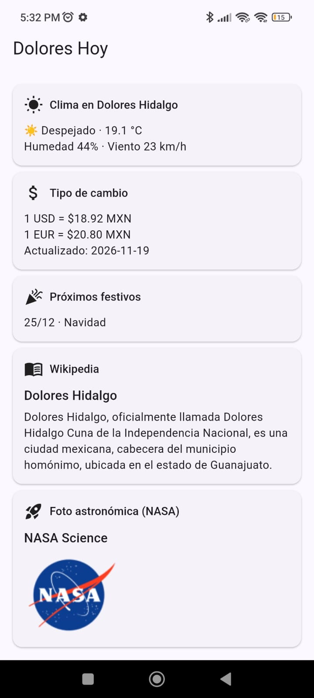

---

## Evidencias TDD (rojo → verde)

**Alumna:** Yaneli Sánchez Cárdenas · **Grupo:** GTID244

Cada ronda muestra primero la prueba en **rojo** (falla porque el código aún no existe) y después en **verde** (pasa con la implementación). En cada captura se ve la prueba que se ejecuta, el resultado en la terminal, mi nombre y mi foto de perfil.

### Ronda 1

**🔴 Rojo — la prueba falla**

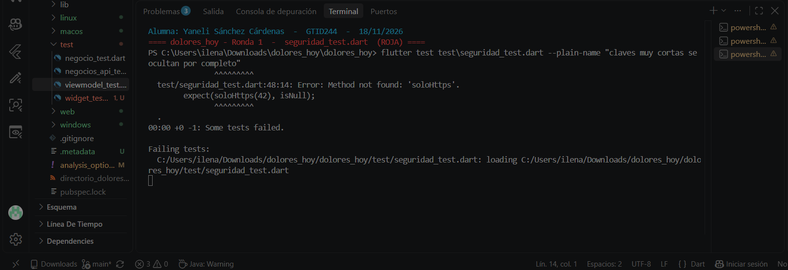

**🟢 Verde — la prueba pasa**

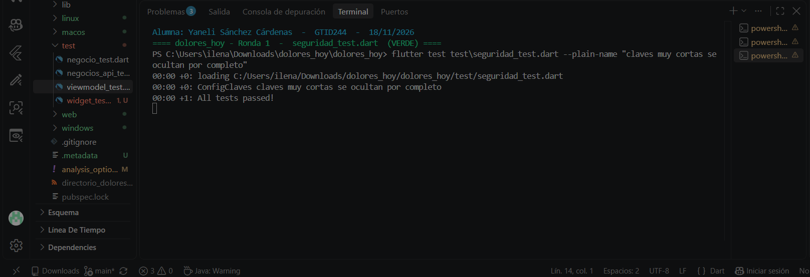

### Ronda 2

**🔴 Rojo — la prueba falla**

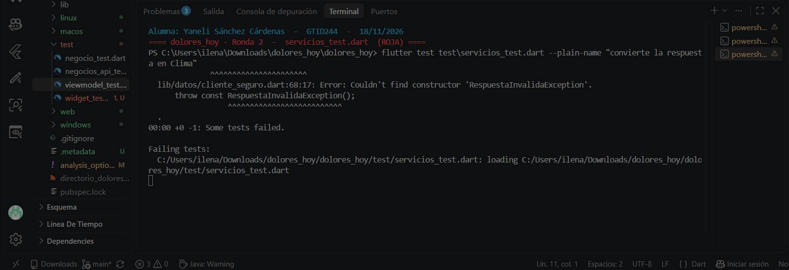

**🟢 Verde — la prueba pasa**

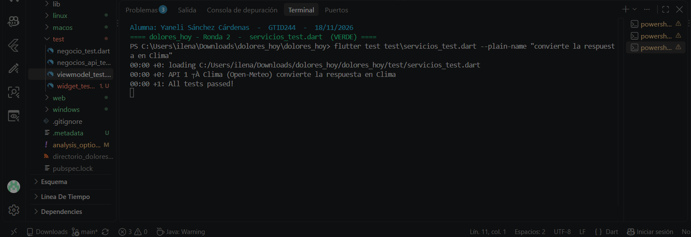

### Ronda 3

**🔴 Rojo — la prueba falla**

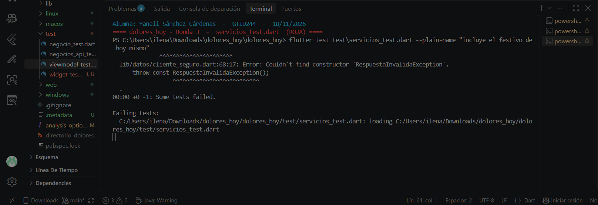

**🟢 Verde — la prueba pasa**

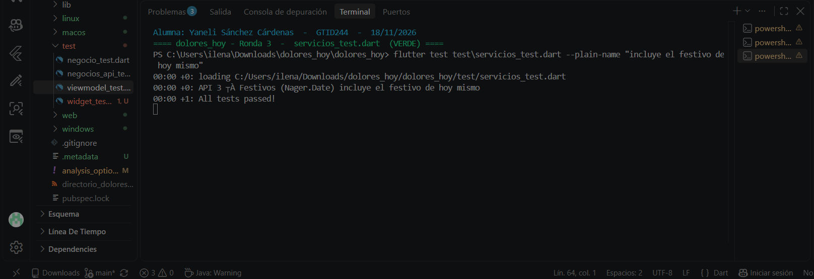

### Ronda 4

**🔴 Rojo — la prueba falla**

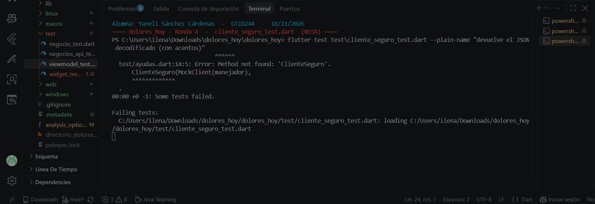

**🟢 Verde — la prueba pasa**

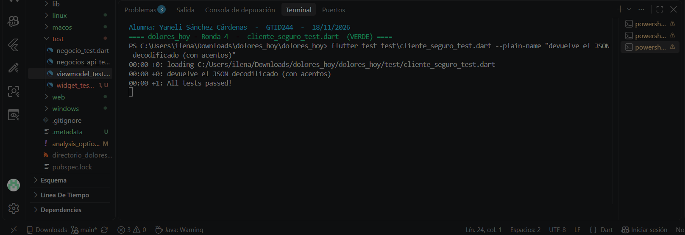

### Ronda 5

**🔴 Rojo — la prueba falla**

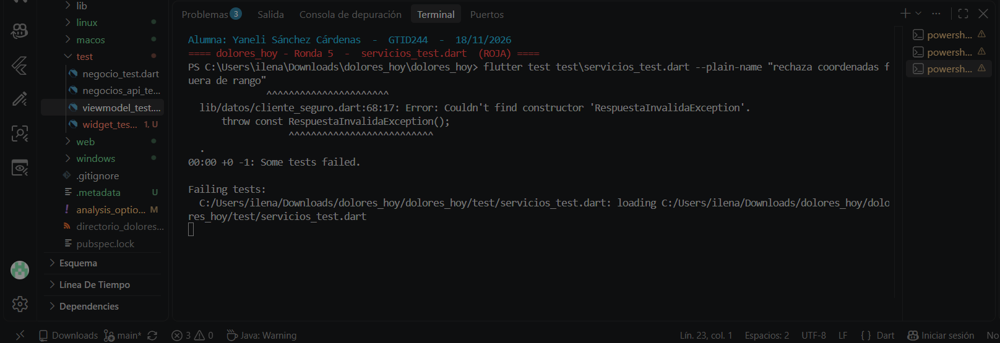

**🟢 Verde — la prueba pasa**

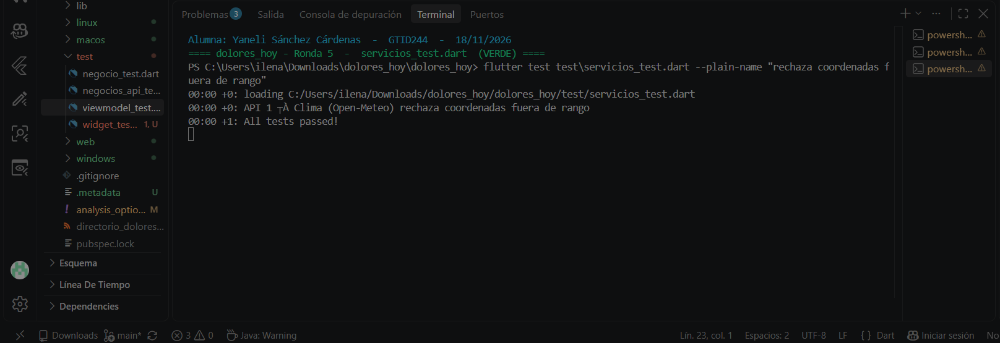

### Ronda 6

**🔴 Rojo — la prueba falla**


**🟢 Verde — la prueba pasa**

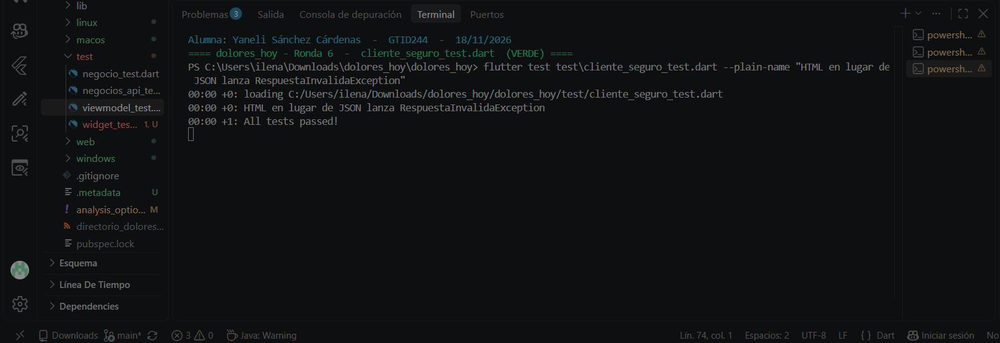
